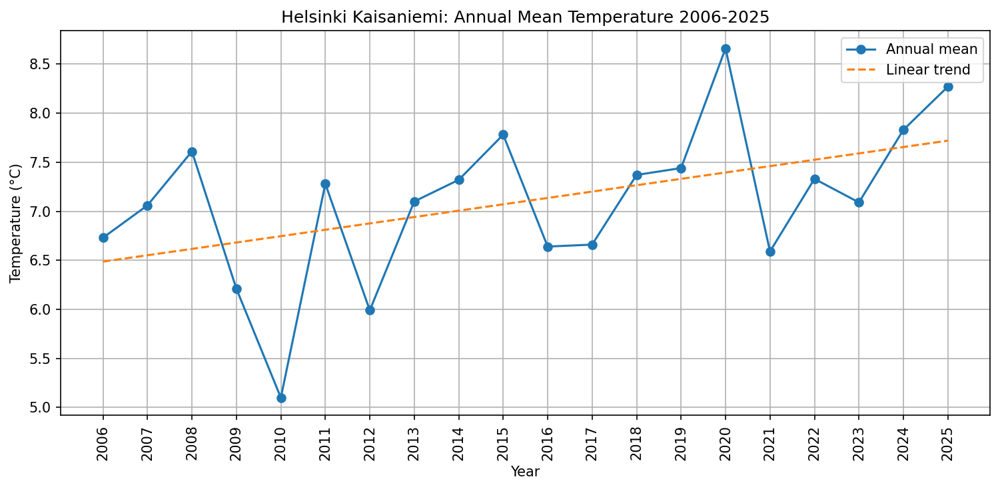
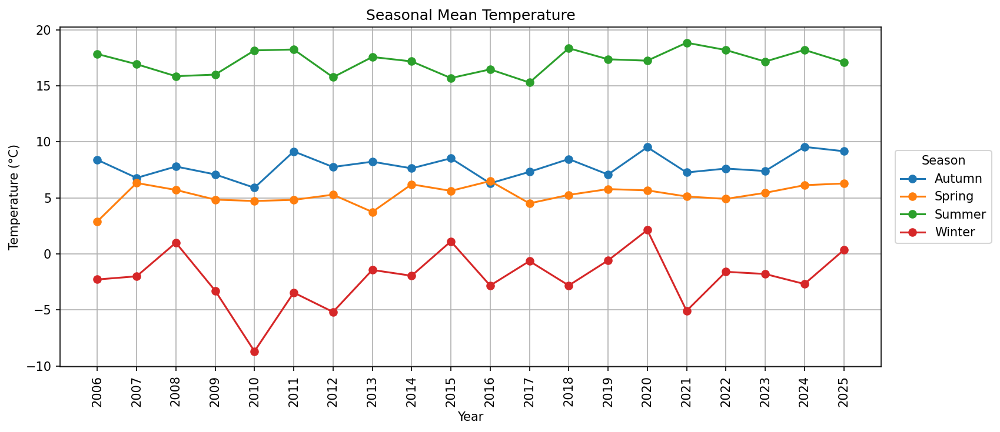

# Helsinki Temperature Analysis 2006-2025

A reproducible analysis of 20 years of hourly temperature observations from the Helsinki Kaisaniemi weather station (Finnish Meteorological Institute, FMI). The project cleans the raw data, quantifies data quality, estimates long-term and seasonal temperature trends, and produces a cautious statistical extrapolation for 2026-2030.

## Research questions

1. Has the annual mean temperature in Helsinki changed between 2006 and 2025?
2. Are the trends visible in individual seasons?
3. Are extreme days (frost days, very cold days, warm days) becoming more or less frequent?
4. What does a simple linear extrapolation say about 2026-2030, and how uncertain is it?

## Main results

| Metric | Value |
|---|---|
| Linear trend of annual mean | +0.065 °C/year (about +0.65 °C/decade) |
| Significance (linear regression) | p = 0.033, R² = 0.23 |
| Kendall tau / p-value | 0.347 / 0.034 |
| Theil-Sen slope (95 % range) | 0.059 °C/year (0.005 to 0.134) |
| Mean 2006-2015 vs 2016-2025 | 6.82 °C vs 7.39 °C (difference 0.57 °C, Welch t-test p = 0.114) |
| Warmest / coldest year | 2020 (8.66 °C) / 2010 (5.10 °C) |
| 2030 extrapolation | about 8.0 °C, 95 % prediction interval 6.3 to 9.8 °C |

Seasonal trends per decade (none significant on its own):

| Season | Trend (°C/decade) | p-value |
|---|---|---|
| Winter | 1.00 | 0.307 |
| Spring | 0.58 | 0.099 |
| Autumn | 0.56 | 0.165 |
| Summer | 0.49 | 0.235 |

Extreme days (computed from hourly data, own thresholds):

| Indicator | Change per decade | p-value |
|---|---|---|
| Frost days (daily min < 0 °C) | -3.99 days | 0.660 |
| Very cold days (daily min <= -20 °C) | -2.32 days | 0.024 |
| Warm days (daily max >= 25 °C) | +4.26 days | 0.256 |

## Figures

### Annual mean temperature with linear trend, 2006-2025



The dashed line is the least squares trend (+0.065 °C/year). Single years such as 2010 (coldest) and 2020 (warmest) deviate strongly from it.

### Seasonal mean temperature by year



Winter varies the most between years, which is why its steepest trend (1.0 °C/decade) is still not statistically significant.

## How to read these results

- The upward trend in the annual mean is statistically significant at the 0.05 level, and two robust methods (Kendall, Theil-Sen) agree with the regression.
- The trend explains only about 23 % of the year-to-year variation. The residual standard deviation (0.72 °C) is larger than the expected 5-year change (about 0.3 °C).
- The lower end of the Theil-Sen range is close to zero, so the size of the trend is uncertain even though its direction is consistently positive.
- The difference between the two decades is not statistically significant.
- The extrapolation is a statistical projection of a straight line, **not** a climate forecast.
- Only one result among the extreme-day tests has p < 0.05, and several tests were run without correction. It should be treated as exploratory.

## Data

- Source: FMI open data, station Helsinki Kaisaniemi, 1.1.2006 - 31.12.2025
- Variables: hourly average, maximum and minimum temperature (°C)
- Size: 174,998 rows, 8 columns
- License: CC BY 4.0, see the attribution section below.
- The raw file is not included. Download it from the FMI observation download service for Helsinki Kaisaniemi, 1.1.2006 - 31.12.2025, hourly temperature.

### Data quality findings

| Check | Result |
|---|---|
| Expected hourly rows (full calendar) | 175,320 |
| Actual rows | 174,998 |
| Missing hours | 322 (about 0.2 %), largest gaps in 2013 (86 h), 2012 (57 h), 2011 (36 h) |
| Non-numeric temperature values | only `-` (missing), converted to NaN |
| Missing temperature values | 23 (average), 32 (maximum), 12 (minimum) |
| Invalid dates | 0 |
| Duplicate timestamps | 20, one per year, always 03:00 on the last Sunday of October (end of daylight saving time) |

The duplicate timestamps are two genuine measurements with different values, so they were kept. The spring clock change removes one local hour per year, which explains part of the missing hours.

## Repository structure

```
Notebooks/              01_Data_Inspection.ipynb
Processed/              annual, monthly and seasonal mean temperature csv files
RAW/                    place the original FMI csv file here (not included, see data section)
annual_mean_trend.png   chart used in this README
seasonal_mean.png       chart used in this README
README.md
```

The notebook finds the data with relative paths, so the folder `RAW` must be located next to the folder `Notebooks`.

## Code walkthrough

The analysis is one notebook, `01_Data_Inspection.ipynb`, organized in eight stages.

| Stage | What the code does | Why |
|---|---|---|
| 1. Environment check | Imports libraries and prints their versions | Documents the environment for reproducibility. Absolute paths are not printed. |
| 2. File discovery | Uses `pathlib` to look only in `RAW` for csv files | A recursive search also found a Jupyter checkpoint copy of the same file. |
| 3. Raw inspection | Prints the first 20 lines with encoding `utf-8-sig` | Checks the header, delimiter and encoding before parsing. |
| 4. Loading | `pd.read_csv(..., low_memory=False)` and a dtype check | Avoids mixed-type warnings. All three temperature columns were loaded as text. |
| 5. Completeness | Compares actual rows per year with 8,760 (8,784 in leap years) using `calendar.isleap` | Quantifies missing hours per year instead of assuming a complete series. |
| 6. Cleaning | `pd.to_numeric(errors="coerce")` for temperatures and a combined `datetime` column | Turns `-` into NaN. Missing values are skipped by pandas when averaging. |
| 7. Duplicate check | Inspects duplicated timestamps by month and year | Shows they come from the autumn clock change, so they are not errors. |
| 8. Aggregation and statistics | Annual, monthly and seasonal means, trend tests, extrapolation, extremes | See below. |

### Statistical methods

- **Annual mean:** simple mean of valid hourly values per year. This can differ slightly from the official FMI mean, which is calculated by its own method.
- **Linear trend:** ordinary least squares with `scipy.stats.linregress` (slope, R², p-value, standard error).
- **Robust trend tests:** Kendall tau (`kendalltau`) and Theil-Sen slope with confidence range (`theilslopes`). Neither assumes normally distributed residuals.
- **Extrapolation:** the 95 % prediction interval is calculated manually as `t * s * sqrt(1 + 1/n + (x0 - mean(x))^2 / Sxx)`, where `s` is the residual standard deviation and `t` comes from the t-distribution with n-2 degrees of freedom. The interval widens the further the year is from the observed period.
- **Two-decade comparison:** Welch t-test (unequal variances) between 2006-2015 and 2016-2025.
- **Seasons:** winter = December-February, spring = March-May, summer = June-August, autumn = September-November. December is assigned to the same calendar year, not to the following winter.
- **Extreme days:** daily minimum and maximum are taken from the hourly minimum and maximum columns, then counted per year and tested with linear regression.

### Design decisions

- Duplicate timestamps were kept, not deleted, because they are valid observations.
- Missing values were not interpolated. The share of missing data is small (about 0.2 %), and interpolation would add values that were never measured.
- Outputs of the notebook contain no absolute file paths.

## Limitations

- Single station and only 20 years of data. A trend of this length is sensitive to individual years (for example the cold 2010).
- Linear model only. Residual autocorrelation and other regression assumptions were not tested.
- No correction for multiple testing.
- The December assignment in the seasonal analysis means winter 2006 contains only January and February of that year.
- Extreme-day thresholds are the author's own definitions and not the official FMI definitions. Annual counts of very cold days are small, so a linear fit is only approximate.
- Station relocation, urban heat island effects and instrument changes were not examined.

## Possible next steps

- Compare with other FMI stations (for example a coastal or inland station).
- Moving average and change-point analysis.
- Seasonal Mann-Kendall test and correction for multiple testing.
- Daily temperature range (day vs night temperature).
- Compare the result with published FMI climate statistics.

## How to run

1. Clone the repository or download it as a zip file.
2. Install the requirements:

```
pip install pandas numpy scipy matplotlib jupyterlab
```

3. Place the FMI csv file in `RAW/` (only one csv file in this folder).
4. Open `Notebooks/01_Data_Inspection.ipynb` in JupyterLab.
5. Run `Kernel > Restart Kernel and Run All Cells`.

Tested with Python 3.12, pandas 2.3, NumPy 2.3.

## Tools

Python, pandas, NumPy, SciPy, Matplotlib, JupyterLab

## Data source and attribution

Observation data: Finnish Meteorological Institute (FMI) open data, station Helsinki Kaisaniemi, 1.1.2006 - 31.12.2025. The data is licensed under the Creative Commons Attribution 4.0 International license (CC BY 4.0): https://en.ilmatieteenlaitos.fi/open-data-licence

The data was downloaded from the FMI observation download service. The analysis in this repository was done by the author and is not an official FMI product.

## Author

**Maryam Talebzadeh**

Data analytics portfolio: [Maryta89 on GitHub](https://github.com/Maryta89)
